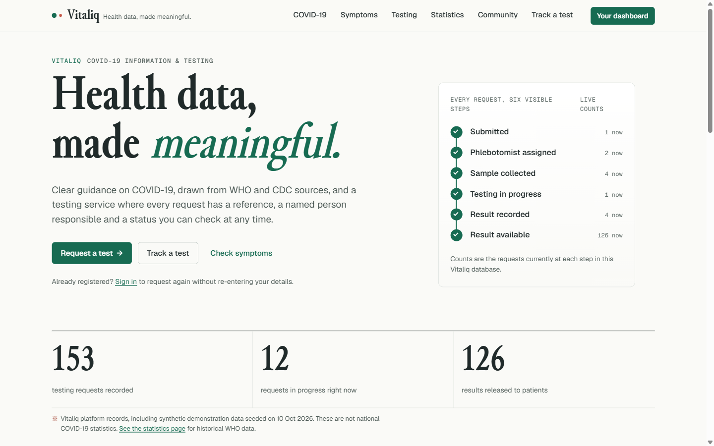
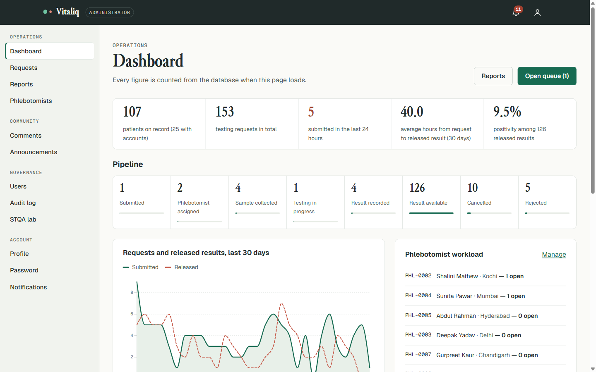
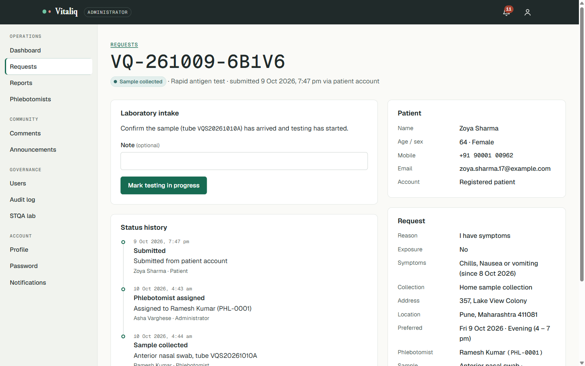
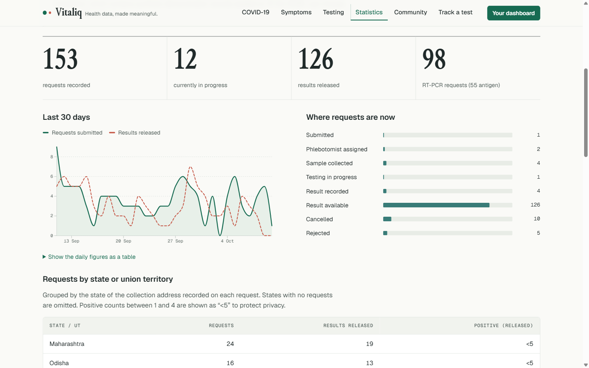
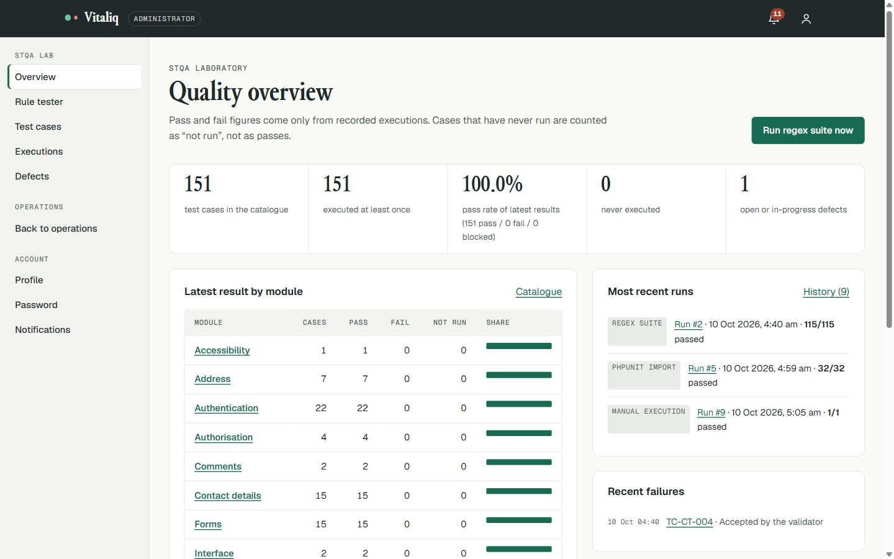

# Vitaliq

**Health data, made meaningful.**

Vitaliq is a COVID-19 public-health information site and testing-management system: a public guide, patient accounts, a sample-collection and laboratory workflow, an administrative dashboard and a working Software Testing and Quality Assurance (STQA) laboratory. It started as a college STQA mini-project and is built and tested as a small production-minded PHP application.

> **Demonstration system.** Vitaliq does not collect real samples or issue real results. All people, phone numbers and requests in the demo data are synthetic. Do not enter real health information.



## Contents

- [Objectives](#objectives)
- [Features](#features)
- [Technology](#technology)
- [Architecture in brief](#architecture-in-brief)
- [Getting started](#getting-started)
- [Testing](#testing)
- [Security notes](#security-notes)
- [Limitations](#limitations)
- [Project status](#project-status)
- [Documentation](#documentation)

## Objectives

1. Give the public accurate, sourced COVID-19 guidance and clearly labelled statistics.
2. Let new and returning patients request a test, receive a reference and follow it to an authorised result.
3. Give administrators a database-backed workflow: queue, phlebotomist assignment, sample collection, laboratory processing, result release, reports and moderation.
4. Make testing a first-class feature: shared validation rules, a test-case catalogue, recorded executions and a defect register, backed by automated tests.

## Features

| Area | What it does |
| --- | --- |
| Public site | Overview, symptoms and warning signs, prevention, testing guidance, FAQ, announcements (with sources), contact and help, privacy notice |
| Statistics | Live platform counts and a 30-day D3 chart, a state/UT summary with small-cell suppression, and India's monthly cases from WHO data (CC BY 4.0, downloaded 10 Oct 2026). Each chart has a data table. |
| New patients | Request a test without an account and get a reference such as `VQ-261010-7K3MP`. Track it with reference + mobile + date of birth. Double submission is blocked. |
| Patient accounts | Registration, sign-in, profile, password change and reset. Request without re-entering details, see history, cancel before collection, view authorised results, print a report, link an earlier guest request. |
| Notifications | Persistent notifications with an unread bell (polled every 30 s), mark one or all as read, and links to the relevant record |
| Administration | SQL-backed dashboard, request queue by status, full workflow actions with history and audit trail, phlebotomist management (archived rather than deleted when referenced), reports with search, filters and formula-safe CSV export, comment moderation, announcements, user activation and staff invitations, audit log |
| Phlebotomist portal | Only the collections assigned to the signed-in phlebotomist, ordered by visit slot, plus specimen and barcode recording |
| STQA laboratory | Rule tester (browser and server verdicts side by side), 151-case catalogue, regex suite runs, manual executions, PHPUnit report import and catalogue coverage, execution history, defect register |

| | |
| --- | --- |
|  |  |
|  |  |

Mobile layout of the request form: [docs/screenshots/mobile-request-form.png](docs/screenshots/mobile-request-form.png).

## Technology

| Layer | Choice |
| --- | --- |
| Server | PHP 8.2.35+, 8.3.36+, 8.4.27+ or 8.5.12+ (tested on 8.4.27). Earlier releases are vulnerable to CVE-2026-109618/109619. No framework and no runtime Composer packages. |
| Database | MariaDB 10.6+ or MySQL 8 (tested on MariaDB 11.4.13), accessed through PDO with native prepared statements |
| Front end | Server-rendered HTML, one CSS file built on design tokens, plain ES modules |
| Motion | GSAP 3.15 with ScrollTrigger, on public pages only and disabled for `prefers-reduced-motion` |
| Charts | A 78 KB D3 v7 subset, loaded only on chart pages |
| Fonts | Junicode (display, subset), Geist and Geist Mono. All SIL OFL 1.1 and self-hosted. |
| Tests | PHPUnit 12 (256 tests) and a Node `node:test` client/server consistency test |

Reasons for each choice, and why jQuery, Velocity.js, PixiJS, Three.js and Snap.svg were not used, are in [docs/TECH_STACK_DECISIONS.md](docs/TECH_STACK_DECISIONS.md).

## Architecture in brief

```
public/index.php ──► App::handle(Request) ──► Router ──► middleware (CSRF, auth, role)
                                                │
                                         Controllers ──► Services ──► Database (PDO)
                                                │            │
                                              Views       AuditLog / Notifications
```

- `src/Core` holds the kernel, router, sessions, CSRF, database, migrator and rate limiter.
- `src/Validation` holds the single rule registry shared with the browser.
- `src/Auth` handles authentication and password tokens.
- `src/Services` holds business logic and SQL.
- `src/Controllers` holds the HTTP layer.
- `views` holds the templates.
- `database` holds migrations, seeds and the QA catalogue.
- `bin` holds the command-line tools.

More detail is in [docs/ARCHITECTURE.md](docs/ARCHITECTURE.md) and [docs/DATABASE.md](docs/DATABASE.md).

## Getting started

Requirements:

- PHP 8.2.35+, 8.3.36+, 8.4.27+ or 8.5.12+ (earlier releases are vulnerable to CVE-2026-109618/109619; `php bin/check-runtime.php` checks this) with the `pdo_mysql`, `mbstring` and `openssl` extensions. Passwords use Argon2id when PHP provides it, as the tested build did, and fall back to bcrypt otherwise.
- MariaDB 10.6+ or MySQL 8
- Composer and Node 18+, needed only for the tests

Full step-by-step setup (including XAMPP and troubleshooting) is in [docs/ENVIRONMENT_SETUP.md](docs/ENVIRONMENT_SETUP.md).

```bash
git clone https://github.com/obstinix/vitaliq.git
```

```bash
cd vitaliq
```

```bash
cp .env.example .env
```

```bash
php bin/generate-key.php
```

Put the generated key into `APP_KEY`, and the database credentials into the `DB_*` settings in `.env`. Create the database and a user for it, for example:

```sql
CREATE DATABASE vitaliq CHARACTER SET utf8mb4 COLLATE utf8mb4_unicode_ci;
CREATE USER 'vitaliq'@'localhost' IDENTIFIED BY 'choose-a-password';
GRANT ALL PRIVILEGES ON vitaliq.* TO 'vitaliq'@'localhost';
```

Then apply the schema:

```bash
php bin/migrate.php
```

Load synthetic demo data. This prints random per-install demo passwords **once**:

```bash
php bin/seed.php
```

Or, instead of demo data, create a first administrator. This prints a one-time set-password link:

```bash
php bin/create-user.php --role=admin --name="Your Name" --email=you@example.org
```

Start the development server:

```bash
php -S 127.0.0.1:8000 -t public public/router.php
```

Then open <http://127.0.0.1:8000>. The web root must be `public/`. With Apache or XAMPP, point the document root (or an alias) at `public/`. A root `.htaccess` also denies everything outside `public/` as a safety net.

## Testing

```bash
composer install
```

```bash
vendor/bin/phpunit
```

```bash
node --test tests/js/rules.test.mjs
```

```bash
php bin/qa.php run
```

PHPUnit needs a separate database named by `TEST_DB_NAME` (default `vitaliq_test`), which the same user can access. The test bootstrap refuses any name that does not end in `_test`, then drops and recreates its tables. To record a PHPUnit run in the STQA lab:

```bash
vendor/bin/phpunit --log-junit build/junit.xml
```

```bash
php bin/qa.php import-junit build/junit.xml
```

```bash
php bin/qa.php cover build/junit.xml
```

Latest recorded results (10 Oct 2026) are in [docs/TEST_EXECUTION_REPORT.md](docs/TEST_EXECUTION_REPORT.md):

- PHPUnit: 256 tests, 1023 assertions, all passing.
- Node consistency test: 3 of 3 passing.
- Regex suite: 115 of 115 passing after one real defect (DEF-004) was found and fixed.
- All 151 catalogue cases executed.
- Lighthouse accessibility: 100 on every audited page.

## Security notes

- Argon2id password hashing, session-ID regeneration at sign-in, `session_version` revocation, idle timeout, and HttpOnly + SameSite=Lax cookies.
- Server-side role checks on every route, and object-level ownership checks. Other people's records return 404.
- PDO native prepared statements everywhere. Sort keys and filters are whitelisted, and LIKE wildcards are escaped.
- CSRF tokens on every POST. No state changes over GET.
- Every dynamic value is escaped with `e()`. The CSP is `script-src 'self'`, with no inline scripts or style attributes.
- Single-use reset and invite tokens expire and are stored as SHA-256 hashes. The forgot-password response is identical whether or not an account exists.
- Rate limits on sign-in, registration, reset, guest test requests, tracking, linking and comments. IP addresses are stored only as keyed hashes.
- CSV exports neutralise spreadsheet formulas. An audit log records administrative and security events.

What was verified, and how, is in [docs/SECURITY_CHECKLIST.md](docs/SECURITY_CHECKLIST.md). Vitaliq has **not** had a regulatory compliance assessment (for example HIPAA or GDPR) and makes no claim of compliance.

## Limitations

- **No email or SMS delivery.** Password-reset messages are written to `storage/mail/` in local development only. Staff invitations show a one-time link to the administrator.
- **Polled notifications.** The bell checks every 30 seconds while the tab is visible. There is no push channel.
- **Local only.** Vitaliq has not been deployed. Statistics are platform data (synthetic in the demo) plus a dated WHO snapshot, not a live feed.
- **ASCII email addresses only.** Internationalised email addresses are rejected; this is documented in the rule tester.
- Further known gaps are listed in [docs/TEST_EXECUTION_REPORT.md](docs/TEST_EXECUTION_REPORT.md#known-limitations).

## Project status

Feature-complete for the STQA brief and verified locally on Windows 11 with PHP 8.4.27 and MariaDB 11.4.13. A security audit on 23 Oct 2026 is in [docs/SECURITY_AUDIT_2026-10-23.md](docs/SECURITY_AUDIT_2026-10-23.md). It is not deployed to any public host.

## Documentation

| Document | Purpose |
| --- | --- |
| [PROJECT_AUDIT](docs/PROJECT_AUDIT.md) | Starting state of the repository and machine |
| [IMPLEMENTATION_PLAN](docs/IMPLEMENTATION_PLAN.md) | Architecture and phases |
| [REQUIREMENTS_TRACEABILITY](docs/REQUIREMENTS_TRACEABILITY.md) | Each requirement mapped to code and evidence |
| [ARCHITECTURE](docs/ARCHITECTURE.md) | Layers, request lifecycle, workflows |
| [DATABASE](docs/DATABASE.md) | Tables, relationships, constraints |
| [TECH_STACK_DECISIONS](docs/TECH_STACK_DECISIONS.md) | Libraries chosen and rejected |
| [ASSET_CREDITS](docs/ASSET_CREDITS.md) | Fonts, libraries and data, with licences |
| [ENVIRONMENT_SETUP](docs/ENVIRONMENT_SETUP.md) | Installing and running |
| [TEST_PLAN](docs/TEST_PLAN.md), [TEST_CASES](docs/TEST_CASES.md), [TEST_EXECUTION_REPORT](docs/TEST_EXECUTION_REPORT.md), [BUG_REPORT](docs/BUG_REPORT.md) | STQA deliverables |
| [SECURITY_CHECKLIST](docs/SECURITY_CHECKLIST.md) | Controls and verification |
| [SECURITY_AUDIT_2026-10-23](docs/SECURITY_AUDIT_2026-10-23.md) | PHP CVE patching, dependency audit, fixes and verification |
| [WORK_LOG](docs/WORK_LOG.md) | Implementation log |

## Licence

MIT, © 2026 Piyush Pandey. Bundled fonts and libraries keep their own licences ([docs/ASSET_CREDITS.md](docs/ASSET_CREDITS.md)).
